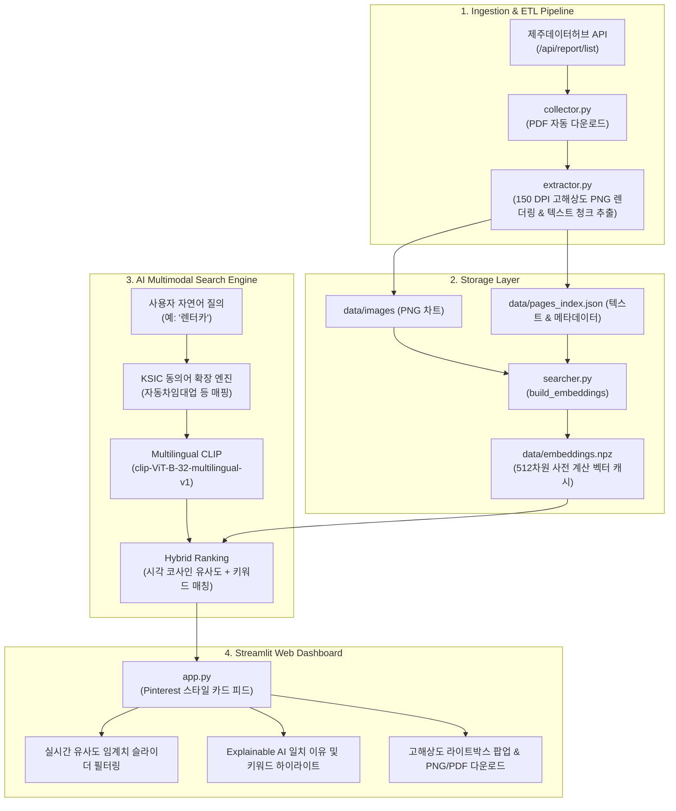

# 🌴 제주데이터허브 AI 멀티모달(CLIP) 이미지 검색 시스템

[](https://jeju-datahub-image-search.streamlit.app)
[](https://www.python.org/downloads/)
[](https://opensource.org/licenses/MIT)

**제주데이터허브(Jeju Data Hub)**의 정기 시계열 빅데이터 분석 보고서(PDF)를 자동으로 수집하여, 본문 텍스트 단락과 고해상도 시각화 차트·그래프 이미지를 자연어 키워드 및 의미 기반으로 검색할 수 있는 **AI 멀티모달(CLIP) 기반 차트 이미지 검색 웹 서비스**입니다.

---

## 📌 1. 프로젝트 배경 및 목적 (Background & Objectives)

* **AS-IS (기존 방식의 한계)**:
  * 제주데이터허브는 방대한 제주도 관광/소비 빅데이터를 정기 리포트(PDF) 형태로 제공합니다.
  * 그러나 원하는 특정 차트(예: 렌터카 매출 추이, 골프장 소비 동향, 외식업 증감 등)를 찾으려면 사용자가 수십 페이지 분량의 PDF 보고서를 일일이 다운로드하고 수동으로 열어보아야 하는 큰 불편함이 존재했습니다.
* **TO-BE (목표 시스템)**:
  * **Google DeepMind Antigravity 2.0**을 활용하여 자연어 키워드 입력만으로 원하는 고해상도 차트 이미지를 실시간으로 탐색하는 멀티모달 검색 웹 서비스를 구축합니다.
  * 일상어 질의를 공식 행정 표준산업분류(KSIC)와 자동 연계하는 동의어 확장 엔진 및 직관적인 Pinterest 스타일의 UI를 구현하고, Streamlit Community Cloud에 공인 배포합니다.

---

## 🌟 2. 주요 핵심 기능 (Key Features)

### 1) 자동 데이터 수집 & 파이프라인 (Automated ETL)
* **Collector (`collector.py`)**: 제주데이터허브 공식 REST API (`/api/report/list`)와 연동하여 최신 정기 리포트 메타데이터 수집 및 원본 PDF 일괄 다운로드.
* **Extractor (`extractor.py`)**: `PyMuPDF` 기반으로 각 페이지별 텍스트 청크를 정제 추출하고, 축 텍스트와 범례가 온전하게 보존되도록 150 DPI 고해상도 PNG 이미지로 렌더링.

### 2) 한국어 지원 멀티모달 CLIP & 하이브리드 검색 엔진 (AI Multimodal Engine)
* **Text Encoder**: `sentence-transformers/clip-ViT-B-32-multilingual-v1` (다국어 및 한국어 텍스트 임베딩)
* **Vision Encoder**: `openai/clip-vit-base-patch32` (고해상도 차트/페이지 이미지 512차원 임베딩)
* **KSIC 표준산업분류 동의어 질의 확장**:
  * 일반 사용자 검색어(예: `렌터카`, `외식`, `골프`, `숙박`, `카페`, `면세점`)를 정부 및 카드사 통계 보고서의 공식 업종명(`자동차임대업`, `한식/중식/일식음식점업`, `골프장운영업`, `호텔업/휴양콘도운영업`, `비알콜음료점업`)과 자동 매핑.
* **하이브리드 랭킹 (Hybrid Scoring)**:
  * CLIP 멀티모달 코사인 유사도(시각/문맥) + 키워드 출현 빈도 스코어를 정밀 결합하여 0~100% 일치율 도출.

### 3) 설명 가능한 AI (Explainable AI - 일치 이유 제공)
* 각 검색 결과 카드에 단순 점수뿐만 아니라 **"왜 이 차트가 검색되었는지"**에 대한 구체적 매칭 근거 표시.
  * 예: *검색어 '렌터카'의 통계 업종명인 '자동차임대' 차트 항목과 매칭되어 91% 일치*
* 본문 텍스트 내 매칭 키워드 노란색 하이라이팅 표시.

### 4) 실시간 유사도 임계치(Threshold) 슬라이더
* 사용자가 슬라이더(0% ~ 100%)를 조절하여 원하는 신뢰도 수준의 이미지만 실시간 필터링.
* `50% 미만 보기` 토글을 제공하여 제외된 저유사도 차트까지 투명하게 확인 가능.

### 5) Pinterest / Google Images 스타일 웹 대시보드 (Streamlit UI)
* 불필요한 텍스트 탭을 배제하고 **화면 전체를 차트 이미지 카드 갤러리**로 구성.
* 반응형 카드 그리드 (3열/4열 선택 가능).
* **🔍 크게 보기 & 다운로드**: Streamlit 대화형 다이얼로그(Dialog Modal)를 통해 원본 해상도 차트 확인, PNG 이미지 파일 다운로드 및 원본 PDF 다운로드 제공.
* **📱 스마트폰 접속용 QR 코드 자동 생성**: 공인 URL 변경 시 사이드바에서 QR 코드가 실시간 렌더링되며 즉시 다운로드 가능.

---

## 🏗️ 3. 시스템 아키텍처 (Architecture)



---

## 📁 4. 디렉터리 구조 (Directory Structure)

```
jeju-datahub-web/
├── app.py                     # Streamlit 웹 대시보드 메인 애플리케이션
├── searcher.py                # Multilingual CLIP 멀티모달 & 하이브리드 검색 엔진
├── collector.py               # 제주데이터허브 API 리포트 수집 모듈
├── extractor.py               # PDF 고해상도 렌더링 및 텍스트 청크 추출 모듈
├── run_pipeline.py            # 수집-추출-임베딩 원클릭 통합 파이프라인
├── industries.json            # 표준산업분류(KSIC) 업종 키워드 목록
├── requirements.txt           # 클라우드 배포용 의존성 목록
├── README.md                  # 프로젝트 설명서
├── .gitignore                 # 깃 버전 관리 제외 파일 정의
└── data/
    ├── reports/               # 원본 PDF 보고서 저장소
    ├── images/                # 150 DPI 렌더링된 차트/페이지 PNG 이미지들
    ├── reports_meta.json      # 리포트 메타데이터
    ├── pages_index.json       # 페이지별 본문 텍스트 및 메타데이터 인덱스
    ├── embeddings.npz         # 사전 계산된 512차원 CLIP 멀티모달 벡터 캐시
    └── public_qr.png          # 스마트폰 접속용 QR 코드 이미지
```

---

## 🚀 5. 로컬 실행 방법 (Local Setup)

### 1) 저장소 클론 및 가상환경 설정
```bash
git clone https://github.com/your-id/jeju-datahub-web.git
cd jeju-datahub-web
python -m venv venv
# Windows
venv\Scripts\activate
# Mac/Linux
source venv/bin/activate
```

### 2) 필수 라이브러리 설치
```bash
pip install -r requirements.txt
```

### 3) 웹 애플리케이션 실행
```bash
streamlit run app.py
```
브라우저에서 `http://localhost:8501`로 자동 접속됩니다.

---

## ☁️ 6. Streamlit Community Cloud 배포 가이드 (Cloud Deployment)

1. **GitHub 저장소 생성 및 푸시**:
   ```bash
   cd jeju-datahub-web
   git init
   git add .
   git commit -m "Initial commit: Jeju Data Hub Multimodal Search System"
   git branch -M main
   git remote add origin https://github.com/<your-id>/jeju-datahub-web.git
   git push -u origin main
   ```
2. **Streamlit Cloud 접속**: [share.streamlit.io](https://share.streamlit.io)에 접속하여 GitHub 계정으로 로그인.
3. **앱 배포 설정**:
   * **Repository**: `<your-id>/jeju-datahub-web`
   * **Branch**: `main`
   * **Main file path**: `app.py`
   * **Deploy!** 버튼 클릭.
4. 배포 완료 후 발급된 공인 URL(예: `https://<your-app>.streamlit.app`)을 확인하고 사이드바의 URL 입력란에 기입하여 QR 코드를 생성합니다.

---

## 🎓 7. 과제 정보 (Course Information)

* **과목명**: 경영정보시스템연구 (Research in Management Information Systems)
* **담당교수**: 김근형 교수님
* **프로젝트명**: 제주데이터허브 AI 멀티모달(CLIP) 이미지 검색 시스템 개발 및 클라우드 배포 (중간고사 대체과제)
* **개발 도구**: Google DeepMind Antigravity 2.0
